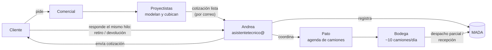

# 01 · Diagnóstico

> Fuentes: nota de gerencia y conversación con gerencia sobre cómo funciona la empresa.
> Lo marcado **(confirmar)** se valida con Patricio Farías ([03-reunion.md](03-reunion.md)).

## Cómo está organizada el área de proyectos

| Pieza | Quiénes | Qué hacen |
|---|---|---|
| Cotizaciones | 3 personas | Reciben las solicitudes de cotización y se las pasan a los proyectistas. |
| Proyectistas | Los dirige Alejandro Farías. Son arquitectos, cubicadores y 2 ingenieros estructurales. | Modelan el pedido del cliente en sus sistemas de dibujo y calculan cuántas piezas de cada producto se necesitan (verticales, diagonales, etc.). |
| Contratos y logística | Patricio "Pato" Farías (`pfarias@`) | Lleva los contratos en curso y los clientes. Administra todos los despachos y recepciones, y lleva la **agenda de camiones**. |
| Asistente técnico | Andrea (`asistentetecnico@`) | Envía al cliente las cotizaciones terminadas, las registra en MADA y coordina los retiros y devoluciones con Pato. |

Cada área funciona por separado. El punto donde se juntan es la casilla `asistentetecnico@`.

## El flujo

1. El cliente le pide algo a un comercial. Los proyectistas lo modelan y cubican.
2. La cotización terminada le llega a Andrea, probablemente por correo **(confirmar)**. Ella la envía al cliente y la registra en MADA.
3. El cliente responde, muchas veces **en el mismo hilo de la cotización**: "lo voy a buscar hoy", "pasamos el jueves", "queremos devolver".
4. Andrea coordina con Pato, y Pato lo anota en su agenda de camiones.
5. El camión del cliente llega a la bodega a retirar o a devolver. Cada movimiento queda registrado en MADA como despacho parcial o recepción.

## Volumen

- **25–30 cotizaciones** enviadas al día desde `asistentetecnico@`.
- Unos **10 camiones** entran cada día a Alzatec a retirar o devolver equipos.

## Qué hace cada sistema

| Sistema | Qué guarda | ¿Lo toca el proyecto? |
|---|---|---|
| **MADA** (INQSOL) | Cotizaciones, pedidos y devoluciones por cliente, inventario al día, y cuánto se ha despachado y facturado por cotización. | **No.** |
| **Correo `asistentetecnico@`** | Las cotizaciones enviadas y las respuestas de los clientes, incluidas las solicitudes de retiro y devolución. | Solo lee una copia. |
| **Agenda de Pato** | Qué camión viene, cuándo y a qué. Hoy probablemente está en Excel o en papel **(confirmar)**. La nota de gerencia está escrita al reverso de una planilla con horarios de 8:00 a 13:00; probablemente sea esta agenda. | Es lo que se automatiza. |

## El problema a resolver

Las solicitudes que implican un camión llegan **mezcladas con las cotizaciones** en la casilla de Andrea. Además vienen en lenguaje libre ("paso mañana en la tarde") y muchas veces escondidas dentro del hilo de una cotización. Alguien tiene que leerlo todo, detectar cuáles requieren camión y traspasarlas a la agenda de Pato.

**Eso es lo que hará el agente.** Es un trabajo de agenda, no de cotizaciones.

## Tipos de solicitud (hipótesis a validar con Pato)

| Tipo | Ejemplo | ¿Va a la agenda? |
|---|---|---|
| **Retiro en bodega** | "Mañana pasamos a retirar lo de la cotización 1234" | Sí, como salida de equipos. |
| **Devolución en bodega** | "El jueves devolvemos los andamios de la obra X" | Sí, como entrada de equipos. |
| **Camión de Alzatec** | Llevar algo que faltó a una obra, o ir a buscar material galvanizado | Sí, en la agenda del camión propio. |
| **Reprogramación o cancelación** | "Mejor el viernes", "no vamos a ir" | Sí, cambia un evento que ya existe. |
| **Cotización sin camión** | Envío de cotización, consulta o modificación | No. |
| **Otro** | Proveedores, publicidad | No. |

**Regla conocida:** los retiros y devoluciones se agendan con **2 días de anticipación** para alcanzar a prepararlos. Pero muchos clientes piden ir el mismo día. **(confirmar cómo se resuelve hoy)**

## Infraestructura de correo

Se revisó en el DNS público, en octubre de 2026.

- El correo está en el hosting compartido **HostingPlus.cl** (cPanel), no en Google ni Microsoft. Se lee por **IMAP**.
- cPanel permite crear un **reenvío con copia**: todo lo que llega a `asistentetecnico@` llega también a una casilla nueva, por ejemplo `agente@`, y el original queda intacto en la casilla de Andrea. Es la forma de que el agente **no interfiera** con su trabajo, y además no necesita su contraseña.
- No hay calendario compartido, así que la agenda la tiene que proveer el proyecto.

## Lo que falta saber (para la reunión con Pato)

1. ¿Dónde y cómo lleva hoy la agenda? ¿Con qué bloques horarios y cuánta capacidad?
2. ¿Cómo se entera hoy de cada solicitud? ¿Qué parte llega por `asistentetecnico@` y qué parte por teléfono, WhatsApp o a su propio correo?
3. ¿Cómo se manejan los pedidos para el mismo día, dado que la regla es de 2 días?
4. ¿Qué viajes hace el camión de Alzatec? ¿Quién los pide y por dónde?
5. ¿Los correos de los clientes traen el número de cotización de MADA?
6. ¿Se le confirma la hora al cliente? ¿Quién lo hace y cómo?
7. ¿Cómo quiere ver la agenda: en pantalla, en el celular o impresa?
