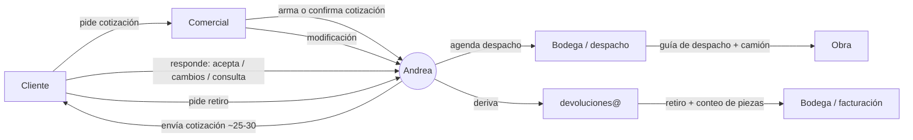

# 01 · Diagnóstico: qué hacía Andrea

> Fuente: nota manuscrita de gerencia + lista de correos para la reunión.
> Todo lo marcado como **(confirmar)** es hipótesis y se valida en la sesión online ([03-reunion.md](03-reunion.md)).
> Lo marcado **✓** ya lo confirmó gerencia.

## Lo que dice la nota

| Nota | Interpretación |
|---|---|
| **ENVIADOS → 25/30 cotizaciones** | Andrea enviaba **25–30 cotizaciones diarias** ✓. Son ~125–150 a la semana y ~550–650 al mes. |
| **ENTRADA:** Respuesta de cotizaciones 25/30 | Recibía unas 25–30 respuestas diarias de clientes (acepta, pide cambios, consulta, rechaza) y les daba curso. |
| Agendamiento de despacho | Coordinaba con el cliente fecha y hora para despachar andamios a obra. |
| Agendamiento de devolución **(derivados)** | Recibía las solicitudes de retiro o devolución y las **derivaba**, probablemente a `devoluciones@`. **(confirmar)** |
| Confirmación de cotización (modificación), **todos los comerciales** | Los comerciales le mandaban cotizaciones confirmadas o con cambios para que ella las procesara. |
| `–` (línea vacía) | Hay más tareas que no alcanzaron a anotar. **(preguntar)** |

## Volumen

Con 25–30 cotizaciones de salida y 25–30 respuestas de entrada al día, más despachos, devoluciones y modificaciones, la casilla de Andrea probablemente movía **60–100 correos diarios** (estimación; se mide con su historial). Eso es una jornada completa solo de correo, y justifica automatizar.

## En una frase

Andrea era el **router humano** del correo comercial. Todo pasaba por ella: leía cada correo, decidía qué era y lo respondía, lo agendaba o lo reenviaba a la persona correcta.

Ese trabajo se puede automatizar en gran parte, porque consiste en **clasificar, extraer datos, rutear y hacer seguimiento**. Lo que conviene dejar en manos de personas es el criterio: negociar, resolver excepciones técnicas y atender reclamos.

## Flujo actual (hipótesis)

## Lo que ya sabemos

**Empresa.** Alzatec S.A. es una empresa chilena de sistemas de andamios: multidireccional, Eurofachada, alzaprimas y torre escala. Tiene oficinas en Lampa (Santiago) y Concón (V Región). Que haya despachos y *devoluciones* indica que gran parte del negocio es **arriendo**: el equipo sale a obra y vuelve. **(confirmar el mix arriendo/venta)**

**Personas que participan** (de la lista para la reunión, todos `@alzatec.com`):

| Casilla | Rol | Relación con Andrea |
|---|---|---|
| `abozzo` | Gerencia | — |
| `cmontes` | ? | ? |
| `pfarias` | ? | ? |
| `pbriceno` | ? | ? |
| `asistentetecnico` | Asistente técnico | ¿Cálculo y diseño de andamios para la cotización? |
| `devoluciones` | Casilla de devoluciones | Recibía lo que Andrea derivaba |

**Sistema de gestión: MADA (INQSOL)** ✓. Según gerencia, las guías y facturas pasan por **MADA**. Es una plataforma web chilena de [INQSOL](https://inqsol.cl/es-cl/mada) hecha para empresas que arriendan equipos: andamios, moldajes y maquinaria. Otras arrendadoras de andamios, como Andamik y Höhe, aparecen entre sus clientes. Esto es lo que dice su sitio:

- **Módulos publicados:**
  - Cotizaciones: "cotizar requerimientos de clientes y seguimiento hasta el despacho", con informes de gestión comercial y de pedidos.
  - Mantenimiento.
  - Disponibilidad.
  - QR por activo.
  - Odómetro, que incluye el cálculo de estados de pago.
  - Presupuesto.
- **Reportes:** cotizaciones vigentes, órdenes de trabajo y despachos, inventarios, trazabilidad y movimientos.
- **Relación con un ERP:** se presenta como complemento de uno. Anuncia "integración con cualquier ERP del mercado" para la facturación y la cobranza, y para los documentos tributarios de los movimientos de material. **(confirmar si Alzatec emite la guía de despacho desde MADA o desde otro sistema conectado)**
- **API:** no publica una API ni documentación técnica.

Consecuencias para el proyecto:

- **MADA es la fuente de verdad** de cotizaciones, inventario y movimientos. El proyecto **no debe duplicarlo**: es una **capa de correo** que trabaja encima de MADA.
- La pregunta técnica más importante es **cómo conectarse con MADA**. Puede ser por API, por exportación e importación de planillas, o con una persona que traspasa los datos que el sistema le deja listos. Esto hay que preguntárselo a INQSOL.
- Lo más probable es que Andrea armara las cotizaciones en MADA y las enviara por correo. **(confirmar)**

**Infraestructura de correo** (revisada en el DNS público, octubre 2026):

- El correo **no** está en Google Workspace ni en Microsoft 365. Está en el hosting compartido **HostingPlus.cl** (cPanel): el MX apunta a `alzatec.com`, el SPF autoriza IPs de HostingPlus y la política es `DMARC p=none`.
- Consecuencias para el diseño:
  - La integración se hace por **IMAP** (lectura, con IMAP IDLE para casi tiempo real) y **SMTP** (envío). No hay API tipo Gmail o Graph, pero para esto no hace falta.
  - Los correos automáticos deben salir **por el SMTP de su mismo hosting**. El SPF ya lo autoriza, así no caen en spam.
  - No hay calendario compartido nativo. Lo más probable es que la agenda de despachos viva en Excel, en papel o en la cabeza de alguien. **(confirmar)** La hoja de la nota está escrita sobre el reverso de una planilla con horarios de 8:00 a 13:00; ¿será la agenda de despachos?
  - Migrar a Google Workspace o Microsoft 365 sería un "nice to have" (calendarios compartidos, mejor entregabilidad, APIs), **pero no es requisito para partir**.

## Lo que NO sabemos (se resuelve en la sesión online)

1. ¿Quién arma la cotización y con qué herramienta (Excel, plantilla Word, otro)? ¿Hay lista de precios?
2. ¿Dónde vive hoy la agenda de despachos y devoluciones? ¿Qué capacidad hay por día (camiones, choferes, sucursal)?
3. ¿Qué módulos de MADA usan? ¿La cotización se arma ahí? ¿La **guía de despacho** y la factura salen de MADA o de otro sistema conectado?
4. ¿MADA tiene API o permite exportar e importar datos? ¿Qué incluye el contrato con INQSOL?
5. ¿Cómo se controla lo **devuelto vs. lo despachado** para cobrar arriendo y faltantes?
6. ¿Quién está cubriendo el trabajo de Andrea hoy y qué se está cayendo?
7. ¿Se puede exportar el historial de la casilla de Andrea? Gerencia dijo que en la sesión le mostrarán todo online; falta conseguir **el export o un acceso de solo lectura**, porque ese historial es la mejor especificación del proceso que vamos a tener.
