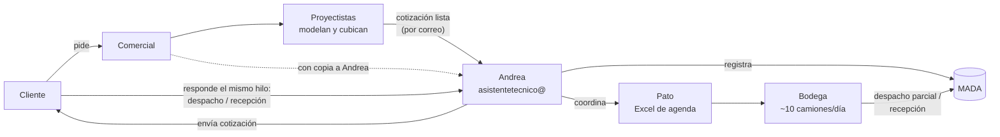

# 01 · Diagnóstico

> Fuentes: nota de gerencia y conversación con gerencia sobre cómo funciona la empresa.
> Lo marcado **(confirmar)** se valida con Andrea y Patricio Farías ([03-reunion.md](03-reunion.md)).

## Cómo está organizada el área de proyectos

| Pieza | Quiénes | Qué hacen |
|---|---|---|
| Cotizaciones | 3 personas | Reciben las solicitudes de cotización y se las pasan a los proyectistas. |
| Proyectistas | Los dirige Alejandro Farías. Son arquitectos, cubicadores y 2 ingenieros estructurales. | Modelan el pedido del cliente en sus sistemas de dibujo y calculan cuántas piezas de cada producto se necesitan (verticales, diagonales, etc.). |
| Contratos y logística | Patricio "Pato" Farías (`pfarias@`) | Lleva los contratos en curso y los clientes. Administra todos los despachos y recepciones, y lleva la **agenda de camiones en Excel**. |
| Asistente técnico | Andrea (`asistentetecnico@`) | Envía al cliente las cotizaciones terminadas, las registra en MADA y coordina despachos y recepciones con Pato. |

## El flujo

1. El cliente le pide algo a un comercial. Los proyectistas lo modelan y cubican.
2. La cotización terminada le llega a Andrea, probablemente por correo **(confirmar)**. Ella la envía al cliente y la registra en MADA.
3. El cliente responde, muchas veces **en el mismo hilo de la cotización**: "lo voy a buscar hoy", "pasamos el jueves", "queremos devolver".
4. Andrea coordina con Pato, y Pato lo anota en su **Excel de agenda**.
5. El camión llega a la bodega. Cada movimiento queda registrado en MADA como despacho parcial o recepción.

### Todo pasa por Andrea

Si una solicitud llega por otro medio, igual se registra a través de Andrea. Por ejemplo, un vendedor la reenvía o la copia (CC). Eso hace de `asistentetecnico@` la **entrada única**: si el agente lee esa casilla, ve todas las solicitudes.

## Volumen

- **25–30 cotizaciones** enviadas al día desde `asistentetecnico@`.
- Unos **10 camiones** entran cada día a Alzatec.

## Qué hace cada sistema

| Sistema | Qué guarda | ¿Lo toca el proyecto? |
|---|---|---|
| **MADA** (INQSOL) | Cotizaciones, pedidos y devoluciones por cliente, inventario al día, y cuánto se ha despachado y facturado por cotización. | **No.** |
| **Correo `asistentetecnico@`** | Cotizaciones, solicitudes de despacho y solicitudes de recepción. | Solo lee una copia. |
| **Excel de agenda de Pato** | Qué camión viene, cuándo y a qué. | **Sí: el agente lo llena** y avisa cuando un día está copado. |

## Tipos de correo

Según gerencia, en la casilla hay tres tipos de correo. Andrea debe definir cómo se reconoce cada uno.

| Tipo | Qué es | ¿Va al Excel? |
|---|---|---|
| **Cotización** | Envío, consulta o modificación de una cotización, sin pedido de camión. | No. |
| **Solicitud de despacho** | El cliente viene a **retirar** equipos de Alzatec para su obra. | Sí. |
| **Solicitud de recepción** | El cliente **devuelve** equipos a Alzatec. | Sí. |

Casos a validar dentro de esos tipos:
- **Cambio de fecha o cancelación** de una solicitud que ya está en el Excel.
- **Casos puntuales con el camión de Alzatec** (gestión interna): llevar a una obra algo que faltó en un despacho, o ir a **retirar material galvanizado**, por ejemplo a la obra de un cliente. **(confirmar de dónde)**
- **Correos que mezclan** cotización y despacho, por ejemplo "acepto la cotización, la voy a buscar mañana".

**Vocabulario ✓:** cuando un cliente dice **"retiro"**, siempre es un **despacho**: viene a buscar equipos a Alzatec. Las devoluciones son **recepciones**.

**Reglas conocidas**
- Despachos y recepciones se agendan con **2 días de anticipación**, pero muchos clientes piden el mismo día. **(confirmar cómo se resuelve)**
- Si en el Excel **el día ya está copado**, hay que **marcar una alerta**. **(confirmar cuándo se considera copado)**

## Infraestructura

- **Correo:** está en **HostingPlus.cl** (cPanel) y se lee por **IMAP**. cPanel permite crear un **reenvío con copia**: todo lo que llega a `asistentetecnico@`, incluidas las copias (CC), llega también a una casilla nueva, `agente@`. El original queda intacto. Así el agente **no interfiere** con Andrea ni necesita su contraseña.
- **Excel de Pato:** falta saber dónde vive (su PC, una carpeta compartida, OneDrive o Google Drive). De eso depende cómo el agente escribe en él. **(confirmar)**

## Lo que falta saber

**Andrea**
1. ¿Cómo distingue una cotización, un despacho y una recepción? Pedirle ejemplos reales de cada uno.
2. ¿Qué datos le pasa a Pato de cada solicitud?
3. ¿Qué otras palabras usan los clientes para pedir despacho o recepción?

**Pato**
4. ¿Dónde vive el Excel y cómo está armado (hojas, filas, columnas)?
5. ¿Cuándo un día está copado? ¿Hay un máximo por día, por bloque o por tipo?
6. ¿Qué se hace cuando está copado? ¿Quién le avisa al cliente?
7. ¿El camión de Alzatec va en el mismo Excel?
