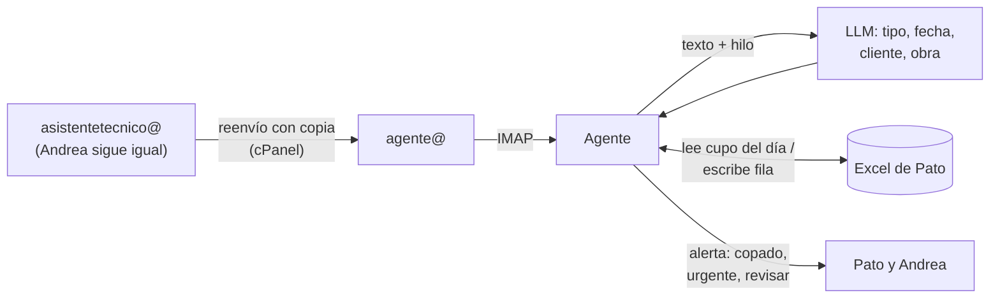

# 02 · Propuesta: agente de agenda

## Qué se construye

Un agente que lee una copia de los correos que llegan a `asistentetecnico@` y separa **cotizaciones**, **solicitudes de despacho** y **solicitudes de recepción**. Con los despachos y recepciones **llena el Excel de agenda de Pato**, y si el día pedido ya está copado, **marca una alerta**.

Andrea sigue trabajando igual. El agente no responde correos ni toca MADA.

## Por qué basta con una casilla

Todas las solicitudes se canalizan por Andrea. Si llegan por otro medio, se registran a través de ella, por ejemplo con un vendedor que la copia. Por eso `asistentetecnico@` es la **entrada única** y el agente ve todo.

## Principios

1. **No interferir con Andrea.** El agente lee una copia. Nunca marca como leído, mueve, borra ni responde nada en su casilla.
2. **El Excel sigue siendo la agenda.** Se mantienen el formato y las columnas. Pato puede seguir escribiendo a mano, y el agente respeta esas filas al calcular el cupo.
3. **Pato decide.** El agente escribe cada fila como **POR CONFIRMAR** y Pato la confirma.
4. **No perder ninguna solicitud.** Si el agente tiene dudas, escribe la fila igual y la marca **REVISAR**.
5. **MADA no se toca.**

## Cómo funciona

1. **Copia del correo.** Un reenvío con copia en cPanel manda todo lo que llega a `asistentetecnico@` también a `agente@`, incluidas las copias (CC) de los vendedores.
2. **Agrupa por hilo.** Si el mismo pedido aparece en varios correos (el del vendedor y la respuesta del cliente), queda una sola fila.
3. **Clasifica:** cotización (no va al Excel), despacho, recepción, cambio de fecha o cancelación, u otro.
4. **Extrae los datos** que piden las columnas del Excel.
5. **Resuelve la fecha.** "Hoy", "mañana" o "el jueves" se convierten en una fecha real, en horario de Chile y con días hábiles y feriados.
6. **Revisa el cupo.** Lee en el Excel lo que ya hay ese día, incluidas las filas escritas a mano, y lo compara con la capacidad.
7. **Escribe la fila** con su estado y, si corresponde, avisa.

## Estados y alertas

El agente agrega una columna **Estado** al Excel. Los colores ayudan a verla de un vistazo.

| Situación | Estado en el Excel | Alerta a |
|---|---|---|
| Hay cupo | 🟨 **POR CONFIRMAR** | — |
| **El día está copado** | 🟥 **SIN CUPO**, con el próximo día que tiene cupo | Pato y Andrea **(validar)** |
| Faltan menos de 2 días | 🟧 **URGENTE** | Pato |
| No se entiende el tipo o la fecha | ⬜ **REVISAR**, con el texto original | Pato |
| Cambio de fecha o cancelación | Actualiza la fila que ya existía | Pato |
| Pato confirma | 🟩 **CONFIRMADO** (lo cambia Pato) | — |

Las alertas parten por correo, que ya tienen. WhatsApp queda para más adelante.

Hay que definir con Pato qué pasa con una solicitud sin cupo: si queda escrita en ese día marcada en rojo, o en una hoja aparte de pendientes.

## Dónde vive el Excel (decisión clave)

| Dónde está hoy | Cómo escribe el agente | Comentario |
|---|---|---|
| OneDrive o SharePoint (Microsoft 365) | API de Microsoft Graph | Escribe aunque Pato lo tenga abierto. |
| Google Drive (Google Sheets) | API de Google Sheets | Igual que el anterior, y además se ve bien en el celular. |
| En el PC de Pato o en una carpeta compartida | Un programa en ese PC | **Frágil:** si el archivo está abierto, no se puede escribir. |

**Recomendación:** si hoy el Excel es un archivo local, moverlo a la nube (OneDrive o Google Sheets) con **exactamente el mismo formato**. Pato lo sigue usando igual y lo puede imprimir.

## Qué se extrae: las columnas del Excel

Las columnas del Excel de Pato definen qué tiene que extraer el agente. Esta es una lista tentativa, a validar con el Excel real:

| Columna | Ejemplo |
|---|---|
| Estado *(nueva)* | POR CONFIRMAR / CONFIRMADO / SIN CUPO / URGENTE / REVISAR |
| Tipo | Despacho / Recepción |
| Fecha y hora | Jueves 16, 10:00 (o "sin hora") |
| Cliente y obra | Constructora X · Edificio Los Robles |
| N° de cotización | El de MADA, si aparece |
| Contacto | Nombre y teléfono |
| Transporte | Patente y chofer, si los indican |
| Detalle | Equipos mencionados |
| Origen *(nueva)* | Asunto, fecha y remitente del correo |

## Stack sugerido

| Pieza | Recomendación |
|---|---|
| Ingesta | Casilla `agente@` en HostingPlus, leída con IMAP IDLE (`imapflow` en Node o `imap-tools` en Python). |
| IA | LLM con salida estructurada (JSON schema). |
| Agenda | El Excel de Pato, por Microsoft Graph o la API de Google Sheets, según dónde viva. |
| Registro interno | Una base pequeña (SQLite o Postgres) para los hilos, los duplicados y la medición. No reemplaza el Excel. |
| Alertas | Correo por el SMTP del hosting. WhatsApp más adelante. |

## Fases

Los plazos son estimados y se ajustan después de la reunión.

| Fase | Qué | Resultado |
|---|---|---|
| **0 · Levantamiento** (esta semana) | Andrea define los tipos con ejemplos. Pato muestra el Excel. Conseguir una copia del Excel y los correos de 1–2 semanas. | Tipos, columnas y regla de cupo definidos, y un set de prueba con la respuesta correcta conocida. |
| **1 · Modo sombra** (~2 semanas) | El agente escribe en una **copia** del Excel, y esa copia se compara con el Excel real. | Precisión medida. Meta: detectar ≥95% de las solicitudes **(validar)**. |
| **2 · En vivo** (~2 semanas) | Escribe en el Excel real como POR CONFIRMAR y manda las alertas de día copado y urgentes. | Pato deja de transcribir. |
| **3 · Casos especiales** | Cambios de fecha y cancelaciones automáticas, viajes del camión de Alzatec, y confirmación al cliente aprobada por Pato. | Menos ida y vuelta. |
| **4 · Extensiones** | Leer MADA (si INQSOL lo permite), WhatsApp, un tablero de indicadores. | — |

## Fuera de alcance (por ahora)

- Enviar o responder correos desde `asistentetecnico@`.
- Registrar cualquier cosa en MADA.
- El trabajo de cotizaciones y de proyectistas.

## Riesgos

| Riesgo | Cómo se cubre |
|---|---|
| El agente no detecta una solicitud | El modo sombra se mide contra el Excel real. Ante la duda escribe la fila como REVISAR. |
| Alguien cambia el formato del Excel | El agente revisa los encabezados antes de escribir. Si no calzan, no escribe y avisa. |
| El Excel está abierto o bloqueado | Tenerlo en la nube (OneDrive o Google Sheets). |
| El agente interpreta mal una fecha | Siempre guarda el texto original en la fila, y Pato confirma. |
| Datos de clientes | Credenciales cifradas, acceso mínimo y registro de lo que escribió el agente. |

## Cómo medimos el éxito

- % de las solicitudes reales que el agente escribe en el Excel.
- % de filas con tipo y fecha correctos.
- Alertas de día copado que fueron correctas.
- Minutos desde que llega el correo hasta que aparece la fila.
- Solicitudes perdidas: **0**.
