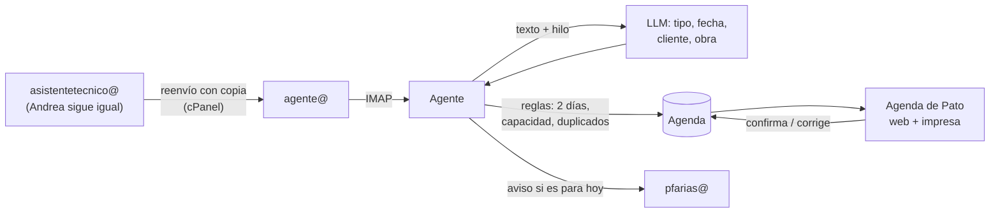

# 02 · Propuesta: agente de agenda

## Qué se construye

Un **agente de agenda**. Lee una copia de los correos que llegan a `asistentetecnico@`, detecta las solicitudes que implican un camión (retiros, devoluciones, viajes del camión de Alzatec) y las deja en la **agenda de Pato** para que él las confirme.

Andrea sigue trabajando igual. El agente no responde correos ni toca MADA.

## Principios

1. **No interferir con Andrea.** El agente lee una copia de los correos. Nunca marca como leído, mueve, borra ni responde nada en su casilla.
2. **No perder ninguna solicitud.** Cuando el agente tiene dudas, igual propone el evento y lo marca "revisar". Una solicitud perdida es mucho peor que una propuesta de más que Pato descarta.
3. **Pato decide.** El agente propone y Pato confirma, corrige o descarta.
4. **MADA no se toca.** Los registros en MADA los siguen haciendo las mismas personas.

## Cómo funciona

1. **Copia del correo.** Un reenvío con copia en cPanel manda todo lo que llega a `asistentetecnico@` también a `agente@`. Si no se pudiera, el plan B es leer la casilla de Andrea en modo de **solo lectura** por IMAP (`EXAMINE` + `BODY.PEEK`, para no marcar nada como leído).
2. **Agrupa por hilo.** Usa las cabeceras `Message-ID`, `In-Reply-To` y `References`, así un "mejor el viernes" actualiza el evento que ya existe en vez de crear otro.
3. **Clasifica y extrae** con un LLM con salida estructurada. Los campos están en la tabla de abajo.
4. **Resuelve las fechas.** "Hoy", "mañana" o "el jueves" se convierten en una fecha real según la hora del correo, en horario de Chile y considerando días hábiles y feriados.
5. **Aplica las reglas.** Si faltan menos de 2 días, marca el evento como **urgente**. También revisa la capacidad por bloque y los duplicados.
6. **Propone el evento** en la agenda como "por confirmar", con un enlace al correo original.
7. **Pato decide** con 1 clic: confirmar, corregir o descartar.

## Qué se guarda de cada evento

| Campo | Ejemplo |
|---|---|
| Tipo | Retiro en bodega · devolución en bodega · camión Alzatec (despacho a obra, retiro en obra, retiro de galvanizado) |
| Fecha y bloque | Jueves 16, 10:00–10:30 (o "sin hora") |
| Cliente y obra | Constructora X · Edificio Los Robles |
| N° de cotización | El de MADA, si aparece en el correo |
| Contacto | Nombre y teléfono |
| Transporte | Patente y chofer, si los indican |
| Detalle | Equipos o cantidades, si los mencionan |
| Urgencia | Normal o urgente (menos de 2 días) |
| Estado | Por confirmar → confirmado → realizado, o cancelado / no llegó |
| Origen | Enlace al correo y texto exacto del cliente |
| Confianza | Alta, media o "revisar" |

## La agenda de Pato

- Vista del día y de la semana, con bloques horarios y capacidad por bloque **(validar)**.
- Las **propuestas por confirmar** aparecen arriba, cada una con el texto original del cliente.
- **Hoja del día imprimible**, si hoy trabajan en papel.
- Funciona en el celular.
- Las solicitudes que llegan por teléfono o WhatsApp se pueden **cargar a mano**, para que toda la agenda esté en un solo lugar.
- **Avisos:**
  - uno inmediato a Pato cuando llega una solicitud para el mismo día;
  - un resumen a fin de día con lo de mañana y pasado. La hora se valida con Pato.

## Stack sugerido

| Pieza | Recomendación |
|---|---|
| Ingesta | Casilla `agente@` en HostingPlus, leída con IMAP IDLE (`imapflow` en Node o `imap-tools` en Python). |
| IA | LLM con salida estructurada (JSON schema). El volumen es de decenas de correos al día. |
| Datos | Postgres (Supabase sirve para la base, el login y los respaldos). |
| Agenda | El stack web que ya uses en zhdevelopment (por ejemplo Next.js), pensado para celular y con vista imprimible. |
| Avisos | Correo por el SMTP del hosting. WhatsApp más adelante. |

## Fases

Los plazos son estimados y se ajustan después de la reunión con Pato.

| Fase | Qué | Resultado |
|---|---|---|
| **0 · Levantamiento** (esta semana) | Reunión con Pato. Conseguir su agenda real de 1–2 semanas y los correos de esas mismas semanas. | Tipos de solicitud y reglas validados, y un set de prueba con la respuesta correcta conocida. |
| **1 · Modo sombra** (~2–3 semanas) | El agente lee y propone en una lista, más un resumen diario. **No reemplaza nada todavía**: se compara contra la agenda real de Pato. | Precisión medida. Meta: detectar ≥95% de las solicitudes **(validar)**. |
| **2 · Agenda digital** (~2–3 semanas) | Pato confirma desde la agenda, imprime la hoja del día y recibe los avisos de urgentes. | Pato deja de transcribir. |
| **3 · Camión Alzatec y clientes** (~2–3 semanas) | Agenda del camión propio y reprogramaciones. Confirmación y recordatorio al cliente desde una casilla de agenda (no desde la de Andrea), con aprobación de Pato. | Se acaba el ida y vuelta para confirmar horas. |
| **4 · Extensiones** | Leer la cotización en MADA para mostrar qué equipos preparar (si INQSOL lo permite), leer otras casillas (`pfarias@`, comerciales) y WhatsApp. | Menos llamadas, y la bodega prepara con anticipación. |

## Fuera de alcance (por ahora)

- Enviar o responder cotizaciones, o escribir desde `asistentetecnico@`.
- Registrar cualquier cosa en MADA.
- El trabajo de cotizaciones y de proyectistas.

## Riesgos

| Riesgo | Cómo se cubre |
|---|---|
| El agente no detecta una solicitud | La fase de modo sombra se mide contra la agenda real. Ante la duda propone y marca "revisar". Hay resumen diario. |
| Hay solicitudes que llegan por otros canales | La agenda permite carga manual. En la fase 4 se suman más casillas. |
| El agente interpreta mal una fecha | Siempre muestra el texto original del cliente, y Pato confirma. |
| Andrea cambia su contraseña o su forma de trabajar | Con el reenvío con copia, el agente no usa su contraseña ni depende de ella. |
| Datos de clientes | Login por persona, credenciales cifradas, respaldo diario y registro de quién confirmó qué. |

## Cómo medimos el éxito

- % de las solicitudes reales que el agente detecta (comparado con la agenda de Pato).
- % de solicitudes con tipo y fecha correctos.
- Minutos desde que llega el correo hasta que la solicitud aparece en la agenda.
- Solicitudes perdidas: **0**.
- Tiempo que Andrea y Pato dedican a coordinar la agenda.
