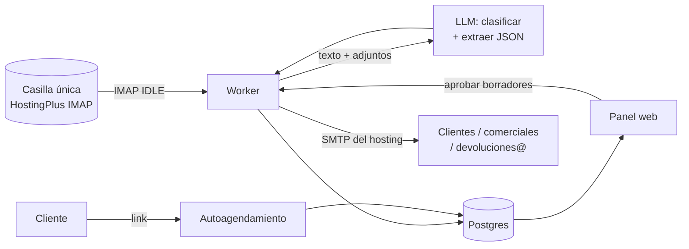

# 02 · Propuesta: automatizar el rol de Andrea

## Idea central

No hay que construir "una plataforma" de una vez. La idea es reemplazar sus **4 tareas** con automatizaciones encadenadas y un panel simple, en fases donde **cada una sirve sola**.

El objetivo realista no es el 100%. Es que **~80% de los correos se resuelva solo o con 1 clic**, y que el ~20% restante llegue ordenado y resumido a la persona correcta. Ningún correo debe perderse.

## Componentes

### 1. Bandeja inteligente (el corazón)

Una **casilla única** (por ejemplo `operaciones@alzatec.com`, o reutilizar la de Andrea) que el sistema lee por IMAP. Con cada correo que entra:

1. **Clasifica** con IA: respuesta a cotización · solicitud de despacho · solicitud de devolución · confirmación o modificación de comercial · otro.
2. **Extrae** los datos: N° de cotización, cliente, RUT, obra, dirección, contacto en obra, fecha pedida, equipos y cantidades, OC.
3. **Actúa** según el tipo:

| Tipo | Lo que hace el sistema | Lo que hace una persona |
|---|---|---|
| Cotización **aceptada** | La marca como ganada, avisa al comercial y le manda al cliente el link para agendar el despacho | — |
| Cotización: **cambios o consulta** | Avisa al comercial con un resumen de 2 líneas y el hilo | El comercial responde |
| **Despacho** | Propone una fecha según la capacidad y deja un borrador de confirmación | El coordinador aprueba con 1 clic |
| **Devolución** | La reenvía a `devoluciones@` con los datos ya extraídos y crea el registro | Devoluciones agenda el retiro |
| **Modificación** de comercial | Actualiza la cotización (nueva versión) y la deja lista para reenviar | El comercial valida |
| **Otro / dudoso** | Lo deja en la cola de revisión | La persona de turno lo resuelve |

**Regla de partida:** el sistema **no le envía nada solo a un cliente**. Deja borradores que se aprueban con 1 clic. Cuando una categoría demuestre una precisión alta y sostenida (por ejemplo >95% durante 2 semanas), se activa el envío automático solo para esa categoría.

### 2. Seguimiento de cotizaciones

- Cada cotización enviada queda registrada, ya sea porque se envía con copia a la casilla única o porque sale desde el cotizador (fase posterior).
- Si el cliente no responde en X días, se le manda un recordatorio automático o se avisa al comercial.
- Tablero: enviadas → respondidas → ganadas o perdidas, por comercial y por semana. Esto probablemente **hoy no existe**, y es lo que más valor le da a gerencia.

### 3. Agenda de despachos y devoluciones

- Un **calendario único** con la capacidad por día (camiones, cuadrillas) y por sucursal (Lampa / Concón).
- Un **link de autoagendamiento** para el cliente, tipo Calendly pero con las reglas de Alzatec: cotización aceptada, OC recibida, sin deuda, etc. Esto elimina la mayor parte del ida y vuelta de correos.
- Recordatorio al cliente el día anterior y aviso a bodega con lo que hay que cargar.

### 4. Panel web

Una sola app con:
- la bandeja clasificada y la cola de revisión,
- el pipeline de cotizaciones,
- el calendario de despachos y devoluciones,
- la ficha por obra: qué se despachó, qué volvió y qué falta.

### 5. Integraciones (fase posterior)

- **ERP o facturación**, para la guía de despacho electrónica y la factura (depende de cuál usen).
- **WhatsApp Business**, para avisos a clientes y choferes (opcional).

## Arquitectura sugerida

| Pieza | Recomendación |
|---|---|
| Ingesta | IMAP IDLE sobre la casilla de HostingPlus (librería `imapflow` en Node o `imap-tools` en Python). |
| IA | LLM con **salida estructurada** (JSON schema) para clasificar y extraer. Con el volumen de esta empresa el costo es marginal frente a un sueldo; el número exacto se mide en el prototipo. |
| Datos | Postgres. Supabase sirve: DB, autenticación y storage para los PDF. |
| Panel | El stack que ya uses en zhdevelopment (por ejemplo Next.js). |
| Envío | SMTP del mismo hosting, para no romper SPF y no caer en spam. |
| Atajo para validar en días | n8n: trigger IMAP → LLM → Supabase o Google Sheet → SMTP. Sirve como prototipo antes de escribir la app. |

Modelo de datos mínimo: `clientes`, `obras`, `cotizaciones` (con versiones), `correos` (con su clasificación y datos extraídos), `despachos`, `devoluciones`, `usuarios`.

## Fases

Los plazos son estimados y se ajustan después de la reunión.

| Fase | Qué | Resultado |
|---|---|---|
| **0 · Levantamiento** (~1 semana) | Reunión. Exportar 2–3 meses de la casilla de Andrea y clasificarlos para conocer el volumen real por categoría. | Alcance cerrado y un set de correos reales para probar. |
| **1 · Modo sombra** (~2–3 semanas) | La bandeja inteligente clasifica y extrae, **pero no actúa**. Solo muestra lo que haría, y eso se compara con lo que hace la persona. | Precisión medida con datos reales. Confianza de gerencia. |
| **2 · Ruteo + borradores + seguimiento** (~2–3 semanas) | Reenvío automático a devoluciones, avisos a comerciales, borradores con 1 clic y recordatorios de cotizaciones. | Primer ahorro real de horas. |
| **3 · Agenda + autoagendamiento** (~3–4 semanas) | Calendario con capacidad y link para clientes. | Se acaba el ida y vuelta para agendar. |
| **4 · Integraciones** | ERP (guías y facturas), WhatsApp, reportes. | Menos doble digitación. |

## Qué NO automatizar

- Negociación de precios y descuentos.
- Cálculo técnico del andamio (es de `asistentetecnico`).
- Reclamos, daños y cobros de faltantes.

Para todo esto el sistema **resume y rutea**, pero no decide.

## Riesgos y cómo cubrirlos

| Riesgo | Mitigación |
|---|---|
| Un correo mal clasificado se pierde | Nada se archiva sin destino. Lo dudoso va a la cola de revisión, y hay un resumen diario de lo pendiente. |
| La IA le responde mal a un cliente | Borradores con aprobación hasta demostrar precisión, y activación por categoría. |
| Los clientes siguen escribiendo a correos personales | Definir la casilla única y comunicarla (firma, cotizaciones, respuesta automática). |
| Datos de clientes y credenciales | Credenciales IMAP y SMTP como secretos, acceso al panel con login por persona y registro de quién aprobó qué. |
| Dependencia de quien lo construyó | Documentación en este repo y un panel que cualquiera de la oficina pueda operar. |

## Cómo medimos el éxito

- Tiempo de primera respuesta al cliente.
- % de cotizaciones con seguimiento y tasa de cierre por comercial.
- Despachos agendados sin reprogramación.
- % de correos que necesitan intervención humana (debería bajar con el tiempo).
- Horas a la semana liberadas.
