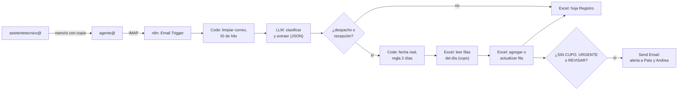

# 05 · Implementación: correo, Excel en OneDrive y n8n

## Decisiones

| Pieza | Decisión |
|---|---|
| Correo | Reenvío con copia en cPanel: `asistentetecnico@` → `agente@alzatec.com`. n8n lee `agente@` por IMAP. |
| Excel | En **OneDrive para empresas** (Microsoft 365), como **Tabla** de Excel. n8n escribe con el nodo Microsoft Excel 365. |
| Orquestación | **n8n**, en una instancia dedicada a Alzatec. |
| IA | Un LLM con salida estructurada (JSON). Se elige entre Claude, GPT o Gemini después de probarlos con correos reales (ver la sección *Modelo de IA*). |
| Alertas | Correo por el SMTP de HostingPlus. |

## 1. Conectarse al correo de Andrea sin tocarlo

Lo hace quien tenga el acceso al hosting de HostingPlus, y toma unos 10 minutos. Necesita la autorización de gerencia.

**Paso a paso en cPanel**

1. **Entrar a cPanel.** Se entra desde el área de clientes de HostingPlus, o directo en `https://alzatec.com:2083`.
2. **Crear la casilla del agente.** Ir a *Correo electrónico → Cuentas de correo electrónico → Crear*.
   - Usuario: `agente`. Dominio: `alzatec.com`.
   - Una contraseña larga.
   - Cuota: 2 GB alcanza. Se puede limpiar cada cierto tiempo.
3. **Crear el reenviador.** Ir a *Correo electrónico → Reenviadores → Agregar reenviador*.
   - *Dirección a reenviar*: `asistentetecnico` (dominio `alzatec.com`).
   - *Destino*: elegir *Reenviar a la dirección de correo electrónico* y escribir `agente@alzatec.com`.
   - Clic en *Agregar reenviador*.
4. **Verificar** que en la lista de reenviadores aparezca `asistentetecnico@alzatec.com → agente@alzatec.com`.
5. **Probar.** Desde un correo externo, mandar un correo de prueba a `asistentetecnico@` y revisar dos cosas:
   - que llegue a **las dos** casillas;
   - que conserve las cabeceras `Message-ID`, `In-Reply-To` y `References`, que el agente usa para agrupar los hilos.

**Qué cambia para Andrea: nada.**
- En cPanel, si una dirección tiene casilla y además reenviador, el correo **se entrega en la casilla y además se copia** al destino.
- Andrea no ve el reenvío.
- No se usa su contraseña.

**Si no hay acceso a cPanel**, se le puede pedir a soporte de HostingPlus con este texto:

> Hola, para el dominio alzatec.com necesitamos: (1) crear la casilla agente@alzatec.com, y (2) crear un reenviador que envíe una **copia** de todo lo que llega a asistentetecnico@alzatec.com hacia agente@alzatec.com, **manteniendo** la entrega normal en asistentetecnico@. Gracias.

### ¿Cuánto cuesta la casilla `agente@`?

Normalmente **nada**: las casillas vienen incluidas en el plan de hosting. Así es en HostingPlus (precios anuales más IVA, según su sitio en octubre de 2026):

| Plan | Precio al año | Casillas incluidas |
|---|---|---|
| Personal NVMe | $64.900 | 10 |
| Emprendedor NVMe y superiores | desde $83.900 | Ilimitadas |

**Cómo saber cuántas quedan:** en cPanel → *Cuentas de correo electrónico* aparece cuántas se usan y el límite (por ejemplo "12 / ∞").

Solo costaría algo si Alzatec está en el plan Personal y ya usa las 10. En ese caso hay dos salidas: subir de plan, o conectarse directo a la casilla de Andrea (ver abajo).

### ¿Y conectarse directo a la casilla de Andrea?

Se puede, por IMAP con el usuario y la contraseña de `asistentetecnico@`.

| | Reenvío a `agente@` | Directo a `asistentetecnico@` |
|---|---|---|
| Casilla extra | Sí (normalmente gratis) | No |
| Contraseña de Andrea | No se usa | **Se necesita.** Si la cambia, el agente deja de funcionar. |
| Si Andrea lee, mueve o borra un correo antes que el agente | No afecta: el agente tiene su copia | **Puede perderse.** Por ejemplo, si el agente estuvo caído y Andrea ya movió el correo a una carpeta. |
| Riesgo de cambiarle algo a Andrea | Ninguno | Hay que abrir la casilla en **solo lectura** y no marcar nada como leído. |
| Ve lo que Andrea envía | No | Sí (carpeta *Enviados*) |
| Acceso a todo el historial de Andrea | No, solo lo nuevo | Sí. Más acceso del necesario. |

**Recomendación:** si la casilla es gratis, el **reenvío** es más seguro y más simple.

Si se va por la conexión directa, hay que hacerlo con cuidado:
- Abrir la casilla en **solo lectura** (`EXAMINE` en vez de `SELECT`) y leer con `BODY.PEEK`, para no marcar nada como leído.
- **Recordar el último UID procesado** en vez de depender de "no leídos". El nodo IMAP de n8n busca por defecto los no leídos, así que si Andrea abre un correo antes, el agente no lo ve. Para esta variante conviene **código propio** (por ejemplo con `imapflow`) en vez de n8n.

**En n8n:** nodo **Email Trigger (IMAP)**.
- Credencial IMAP de `agente@`: servidor `mail.alzatec.com` (el exacto está en cPanel → *Conectar dispositivos*), puerto 993, SSL.
- *Action*: **Mark as Read**. Así se marcan como leídos solo en la casilla del agente, nunca en la de Andrea.

**Límite:** el reenvío copia lo que **llega** a Andrea, incluidas las copias (CC), pero no lo que ella envía. Para detectar solicitudes de clientes y vendedores es suficiente.

## 2. El Excel en OneDrive

### Requisito: OneDrive **para empresas**

n8n escribe en Excel a través de la API de Excel de Microsoft Graph. La documentación oficial de Microsoft dice:

> "Support for workbooks stored in OneDrive Consumer platform is still not available. At this time, only the files stored in business platform are supported by Excel REST APIs."

Es decir: **con un OneDrive personal (cuentas hotmail u outlook.com) esa API no está soportada.** Solo funciona con **OneDrive para empresas y SharePoint** (Microsoft 365). Además, no acepta archivos `.xls`.

Con una cuenta personal, el único camino sería descargar el archivo completo, modificarlo y volver a subirlo. Para una agenda que Pato está editando al mismo tiempo eso es peligroso: **la subida pisa los cambios que Pato hizo mientras tanto**. La API de empresa, en cambio, agrega la fila dentro del archivo abierto, sin pisar nada.

| Si el Excel está en… | Qué hacer |
|---|---|
| OneDrive o SharePoint de una cuenta Microsoft 365 de empresa | Listo. Se usa esa cuenta. |
| OneDrive personal, o en el PC | Contratar **1 licencia Microsoft 365 Business Basic** (US$7 por usuario al mes desde julio de 2026) para una cuenta tipo `agenda@alzatec.onmicrosoft.com`. Se sube el Excel a su OneDrive y se comparte con Pato y Andrea. **El correo sigue en HostingPlus**; no hay que tocar el DNS. |

Que el Excel viva en una **cuenta de la empresa** y no en la de una persona evita que se rompa si esa persona cambia su contraseña o se va.

### Preparar el Excel (una vez)

1. Tiene que ser `.xlsx`, no `.xls`.
2. **Convertir la agenda en una Tabla de Excel** (*Insertar → Tabla*), con una fila por camión. El nodo de n8n agrega filas al final de la tabla y las lee filtrando por fecha.
   - Si hoy es una grilla, por ejemplo con horarios en columnas, igual se puede escribir llamando a Graph desde el nodo HTTP Request. Pero es más frágil: conviene acordar con Pato una tabla, y si quiere, una vista de grilla que se arme con fórmulas.
3. **Agregar tres columnas:**
   - **Estado**: POR CONFIRMAR, CONFIRMADO, SIN CUPO, URGENTE o REVISAR.
   - **Origen**: asunto y fecha del correo.
   - **ID hilo**: puede quedar oculta. Sirve para no duplicar filas y para encontrar la fila cuando llega un cambio de fecha.
4. **Formato condicional** en Estado, para los colores. Lo hace Excel; el agente solo escribe el texto.
5. Pato lo abre desde OneDrive, en el escritorio con *Autoguardado* activo o en la web. Así ve aparecer las filas nuevas mientras lo tiene abierto.

### Conectar n8n ("la API de Microsoft")

La API de Microsoft **no se compra**: viene incluida con la cuenta Microsoft 365. Lo que se hace es **autorizar a n8n** para que use esa cuenta. Hay dos caminos.

**A. Con n8n Cloud (más simple)**
1. En n8n: *Credentials → New → Microsoft Excel OAuth2 API → Connect my account*.
2. Entrar con la cuenta dueña del Excel (por ejemplo `agenda@alzatec.onmicrosoft.com`) y aceptar los permisos.

Listo: n8n Cloud no pide registrar ninguna aplicación.

**¿Por qué en n8n Cloud es un clic?** Porque n8n ya registró **su propia** aplicación en Microsoft, y uno solo autoriza esa aplicación. Si n8n corre en tu servidor, o si escribes **tu propio código** sin n8n, no hay aplicación prestada: **hay que registrar una propia**. Se hace una sola vez, es gratis y toma unos 10 minutos.

**B. Con n8n en un servidor propio (self-hosted)**

Hay que registrar una aplicación en Microsoft. Es gratis:
1. Entrar a `https://entra.microsoft.com` con la cuenta administradora de Microsoft 365.
2. Ir a *Aplicaciones → Registros de aplicaciones → Nuevo registro*.
   - Nombre: `n8n agenda Alzatec`.
   - Tipos de cuenta: *cualquier directorio organizativo y cuentas personales de Microsoft*. Es lo que indica la guía de n8n. Si se elige "solo este directorio", n8n puede fallar al conectarse.
   - URI de redirección: plataforma *Web*, y pegar la *OAuth Callback URL* que muestra n8n al crear la credencial.
3. Copiar el **Id. de aplicación (cliente)**: es el *Client ID*.
4. En *Certificados y secretos → Nuevo secreto de cliente*, copiar el **Valor**. Es el *Client Secret* y se muestra una sola vez. Vence (máximo 2 años): **dejar un recordatorio para renovarlo**.
5. En n8n, crear la credencial *Microsoft Excel OAuth2 API*, pegar el Client ID y el Secret, luego *Connect my account*, entrar con la cuenta dueña del Excel y aceptar.
6. Si Microsoft pide "aprobación del administrador", el administrador de la cuenta Microsoft 365 la da una vez.

**C. Con código propio (sin n8n)**

Se registra la app igual que en B, pero conviene el modo **solo aplicación** (*client credentials*): el agente se conecta con el Client ID y el Secret, sin que nadie inicie sesión.
- Permiso de **aplicación** en Microsoft Graph: `Files.ReadWrite.All`, o `Sites.Selected` si el Excel vive en un sitio de SharePoint y se quiere dar acceso solo a ese sitio.
- El administrador da el consentimiento una vez.
- Es lo más estable para un servicio que corre solo: no depende de la sesión de una persona.

**Después, en el flujo:** nodo **Microsoft Excel 365**, con estas operaciones sobre la tabla de la agenda:
   - *Get Rows*: para contar el cupo del día.
   - *Lookup*: para buscar por ID hilo.
   - *Append*: para agregar la fila.

Para producción existe la opción *Service Principal (App-Only)*: no depende de que una persona haya iniciado sesión, pero requiere consentimiento de administrador del tenant.

## 3. Dónde corre n8n

Al día llegan unos 100 correos. Cada uno es una ejecución, o sea unas **2.500–3.000 ejecuciones al mes**.

| Opción | Costo aprox. | A favor | En contra |
|---|---|---|---|
| **n8n Cloud** | Starter: €20 al mes (2.500 ejecuciones). Pro: €50 al mes (10.000). Precios con facturación anual. | Nadie mantiene servidores. Conectar Microsoft es un clic, sin registrar una app. | Starter queda justo con este volumen. |
| **n8n self-hosted** en un VPS con Docker | Unos US$5–10 al mes de VPS | Sin límite de ejecuciones. Más barato. | Hay que mantener actualizaciones y respaldos. Necesita dominio con HTTPS para el OAuth de Microsoft. |

**Recomendación**
- Para desarrollar y para el modo sombra: n8n en local o en una prueba de n8n Cloud.
- Para producción: **una instancia a nombre de Alzatec**, sea un VPS o una cuenta n8n Cloud.
- **Licencia:** construir flujos para un cliente está permitido. Lo que requiere licencia comercial es alojar en tu propia instancia los flujos y credenciales de varios clientes. Por eso conviene que la instancia sea de Alzatec. Ante la duda, confirmar con n8n (`license@n8n.io`).

### Detalles del flujo

- **IA:** un solo nodo llama al modelo y le pide **salida estructurada** (un JSON schema), para que la respuesta siempre sea un JSON válido. Los tres proveedores lo soportan. Puede ser el nodo del proveedor en n8n, o un nodo **HTTP Request** contra su API si se necesita control total. Como es un solo nodo, **cambiar de modelo es cambiar ese nodo**. El *prompt* incluye las definiciones de Andrea y unos 10 ejemplos reales de cada tipo.
- **Fechas:** un nodo **Code** convierte "hoy", "mañana" o "el jueves" en una fecha real, con la zona `America/Santiago`, considerando días hábiles y una lista de feriados de Chile.
- **Duplicados y cambios:** antes de agregar una fila, el flujo busca por **ID hilo**. Si ya existe, actualiza esa fila en vez de crear otra.
- **Registro:** una hoja aparte (*Registro*) guarda cada correo procesado y cómo se clasificó. Sirve para medir la precisión en el modo sombra.
- **Errores:** un *Error Workflow* de n8n avisa por correo si algo falla. El correo no se pierde: sigue en `agente@`.

### Modelo de IA

**Para esta tarea sirven todos.** Hay que clasificar cada correo en unas 5 categorías, sacar fecha, cliente y obra, y entender español de Chile ("paso mañana en la tarde"). Cualquier modelo actual de Anthropic, OpenAI o Google lo hace bien. La diferencia la van a hacer **las definiciones y los ejemplos de Andrea** más que el modelo.

Costo estimado con **3.000 correos al mes** (100 al día), unos 3.000 tokens de entrada y hasta 1.000 de salida por correo. Es un techo: el *prompt caching* de las instrucciones fijas lo baja.

| Modelo | ID | Precio por millón de tokens (entrada / salida) | Costo al mes (techo) |
|---|---|---|---|
| Claude Opus 5.5 | `claude-opus-5-5` | US$4 / US$20 | ~US$95 |
| Claude Sonnet 5.5 | `claude-sonnet-5-5` | US$2 / US$10 | ~US$50 |
| GPT-6.1 Sol | `gpt-6.1-sol` | US$2 / US$10 | ~US$50 |
| Gemini 3.8 Flash | `gemini-3.8-flash` | US$0,75 / US$3,75 (introductorio hasta el 31-12-2026; luego US$1,50 / US$7,50) | ~US$20, luego ~US$35 |
| Claude Haiku 5.5 | `claude-haiku-5-5` | US$0,10 / US$0,50 | ~US$2–3 |

Notas:
- No encontré un precio publicado de "Gemini 3.8 Pro". El de la tabla es el **Flash**.
- Los precios de GPT y Gemini salen de anuncios y sitios de precios de octubre de 2026. **Confirmarlos** en la página de cada proveedor antes de presupuestar.

**Cómo elegir: con datos, no por marca.**
1. Con los correos que Andrea clasificó (100–200), correr **los mismos correos** con 2 o 3 modelos.
   - Por ejemplo: uno de gama media (Sonnet 5.5 o GPT-6.1 Sol), uno económico (Haiku 5.5 o Gemini 3.8 Flash) y, si hace falta, uno tope (Opus 5.5).
2. Comparar tres cosas:
   - cuántos despachos y recepciones detecta (lo más importante: que no se le escape ninguno);
   - si acierta la fecha;
   - el costo.
3. Elegir **el más barato que cumpla la meta**. Si dos empatan, da lo mismo cuál.

**Lo mismo para cualquier proveedor**
- La cuenta de API va **a nombre de Alzatec**, con su tarjeta, y con un **límite de gasto mensual** configurado.
- Usar siempre el **plan pagado** de la API. En Gemini, el nivel gratuito puede usar los datos para mejorar los productos de Google.
- **Privacidad:** el contenido de los correos de clientes pasa por el proveedor de IA. Hay que comentarlo con gerencia.

## 4. Accesos a pedir

| Qué | Quién lo da | Para qué |
|---|---|---|
| cPanel de HostingPlus, o alguien que cree `agente@` y el reenvío | Quien administra el hosting | Leer el correo |
| Cuenta Microsoft 365 de empresa, o aprobar la licencia Business Basic | Gerencia | Que el Excel viva en OneDrive para empresas |
| Acceso a Azure / Entra ID de esa cuenta | La misma cuenta | Registrar la app para n8n |
| Cuenta de API del modelo elegido (Anthropic, OpenAI o Google), a nombre de Alzatec | Gerencia | El costo de IA lo paga la empresa |
| VPS o cuenta n8n Cloud a nombre de Alzatec | Gerencia | Dónde corre el agente |

## 5. Orden para montar el modo sombra

1. Con los correos y el Excel de 1–2 semanas, armar el *prompt* y medir **offline** cuánto acierta (sin conectar nada).
2. Crear `agente@` y el reenvío, y conectar el trigger IMAP en n8n.
3. Subir **una copia** del Excel a OneDrive y conectar n8n a esa copia.
4. Correr 1–2 semanas comparando la copia contra el Excel real de Pato.
5. Si cumple las metas, apuntar n8n al Excel real (fase 2).
