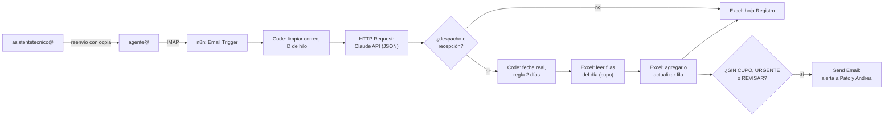

# 05 · Implementación: correo, Excel en OneDrive y n8n

## Decisiones

| Pieza | Decisión |
|---|---|
| Correo | Reenvío con copia en cPanel: `asistentetecnico@` → `agente@alzatec.com`. n8n lee `agente@` por IMAP. |
| Excel | En **OneDrive para empresas** (Microsoft 365), como **Tabla** de Excel. n8n escribe con el nodo Microsoft Excel 365. |
| Orquestación | **n8n**, en una instancia dedicada a Alzatec. |
| IA | Claude API, llamada desde n8n con salida estructurada (JSON). |
| Alertas | Correo por el SMTP de HostingPlus. |

## 1. Conectarse al correo de Andrea sin tocarlo

Lo hace quien administre el cPanel de HostingPlus, y toma unos 10 minutos:

1. **Crear la casilla** `agente@alzatec.com`, en cPanel → *Cuentas de correo*.
2. **Crear el reenvío**, en cPanel → *Reenviadores* → *Agregar reenviador*: dirección `asistentetecnico`, destino `agente@alzatec.com`.
   - La casilla de Andrea **sigue recibiendo todo igual**. El reenvío es una copia.
   - No se usa la contraseña de Andrea.
3. **Probar.** Mandar un correo a `asistentetecnico@` y verificar dos cosas: que llega a ambas casillas, y que conserva las cabeceras `Message-ID`, `In-Reply-To` y `References`, porque el agente las usa para agrupar los hilos.

**En n8n:** nodo **Email Trigger (IMAP)**.
- Credencial IMAP de `agente@`: servidor `mail.alzatec.com` (el exacto está en cPanel → *Conectar dispositivos*), puerto 993, SSL.
- *Action*: **Mark as Read**. Así se marcan como leídos solo en la casilla del agente, nunca en la de Andrea.

**Límite:** el reenvío copia lo que **llega** a Andrea, incluidas las copias (CC), pero no lo que ella envía. Para detectar solicitudes de clientes y vendedores es suficiente.

## 2. El Excel en OneDrive

### Requisito: OneDrive **para empresas**

n8n escribe en Excel a través de la API de Excel de Microsoft Graph. Esa API funciona con **OneDrive para empresas y SharePoint** (Microsoft 365). Con un OneDrive **personal** (cuentas hotmail u outlook.com) no está soportada de forma confiable.

| Si el Excel está en… | Qué hacer |
|---|---|
| OneDrive o SharePoint de una cuenta Microsoft 365 de empresa | Listo. Se usa esa cuenta. |
| OneDrive personal, o en el PC | Contratar **1 licencia Microsoft 365 Business Basic** (US$7 por usuario al mes desde julio de 2026) para una cuenta tipo `agenda@alzatec.onmicrosoft.com`. Se sube el Excel a su OneDrive y se comparte con Pato y Andrea. **El correo sigue en HostingPlus**; no hay que tocar el DNS. |

Que el Excel viva en una **cuenta de la empresa** y no en la de una persona evita que se rompa si esa persona cambia su contraseña o se va.

### Preparar el Excel (una vez)

1. Tiene que ser `.xlsx`, no `.xls`.
2. **Convertir la agenda en una Tabla de Excel** (*Insertar → Tabla*), con una fila por camión. El nodo de n8n agrega filas al final de la tabla y las lee filtrando por fecha.
   - Si hoy es una grilla, por ejemplo con horarios en columnas, igual se puede escribir llamando a Graph desde el nodo HTTP Request. Pero es más frágil: conviene acordar con Pato una tabla, y si quiere, una vista de grilla que se arme con fórmulas.
3. **Agregar tres columnas:**
   - **Estado**: POR CONFIRMAR, CONFIRMADO, SIN CUPO, URGENTE o REVISAR.
   - **Origen**: asunto y fecha del correo.
   - **ID hilo**: puede quedar oculta. Sirve para no duplicar filas y para encontrar la fila cuando llega un cambio de fecha.
4. **Formato condicional** en Estado, para los colores. Lo hace Excel; el agente solo escribe el texto.
5. Pato lo abre desde OneDrive, en el escritorio con *Autoguardado* activo o en la web. Así ve aparecer las filas nuevas mientras lo tiene abierto.

### Conectar n8n

1. En el portal de Azure → **Microsoft Entra ID → Registros de aplicaciones**, crear una app:
   - URL de redirección: la URL de OAuth que muestra n8n al crear la credencial.
   - Permisos delegados: `Files.ReadWrite` y `offline_access`.
   - Copiar el *Client ID* y crear un *Client Secret*.
2. En n8n, crear la credencial **Microsoft Excel OAuth2** y entrar con la cuenta dueña del Excel.
3. Nodo **Microsoft Excel 365**, con estas operaciones sobre la tabla de la agenda:
   - *Get Rows*: para contar el cupo del día.
   - *Lookup*: para buscar por ID hilo.
   - *Append*: para agregar la fila.

Para producción existe la opción *Service Principal (App-Only)*: no depende de que una persona haya iniciado sesión, pero requiere consentimiento de administrador del tenant.

## 3. Dónde corre n8n

Al día llegan unos 100 correos. Cada uno es una ejecución, o sea unas **2.500–3.000 ejecuciones al mes**.

| Opción | Costo aprox. | A favor | En contra |
|---|---|---|---|
| **n8n Cloud** | Starter: €20 al mes (2.500 ejecuciones). Pro: €50 al mes (10.000). Precios con facturación anual. | Nadie mantiene servidores. | Starter queda justo con este volumen. |
| **n8n self-hosted** en un VPS con Docker | Unos US$5–10 al mes de VPS | Sin límite de ejecuciones. Más barato. | Hay que mantener actualizaciones y respaldos. Necesita dominio con HTTPS para el OAuth de Microsoft. |

**Recomendación**
- Para desarrollar y para el modo sombra: n8n en local o en una prueba de n8n Cloud.
- Para producción: **una instancia a nombre de Alzatec**, sea un VPS o una cuenta n8n Cloud.
- **Licencia:** construir flujos para un cliente está permitido. Lo que requiere licencia comercial es alojar en tu propia instancia los flujos y credenciales de varios clientes. Por eso conviene que la instancia sea de Alzatec. Ante la duda, confirmar con n8n (`license@n8n.io`).

### Detalles del flujo

- **IA:** usar el nodo **HTTP Request** contra la API de mensajes de Claude, con salida estructurada (`output_config.format` con un JSON schema). Eso da control total sobre el modelo y garantiza un JSON válido. El *prompt* incluye las definiciones de Andrea y unos 10 ejemplos reales de cada tipo.
- **Fechas:** un nodo **Code** convierte "hoy", "mañana" o "el jueves" en una fecha real, con la zona `America/Santiago`, considerando días hábiles y una lista de feriados de Chile.
- **Duplicados y cambios:** antes de agregar una fila, el flujo busca por **ID hilo**. Si ya existe, actualiza esa fila en vez de crear otra.
- **Registro:** una hoja aparte (*Registro*) guarda cada correo procesado y cómo se clasificó. Sirve para medir la precisión en el modo sombra.
- **Errores:** un *Error Workflow* de n8n avisa por correo si algo falla. El correo no se pierde: sigue en `agente@`.

### Modelo y costo de IA (estimación gruesa)

Se asume que cada correo tiene unos 3.000 tokens de entrada (instrucciones, ejemplos y correo) y hasta unos 1.000 de salida.

| Modelo | ID | Costo aprox. con ~100 correos al día |
|---|---|---|
| Claude Opus 5.5 (el más capaz, por defecto) | `claude-opus-5-5` | US$50–100 al mes |
| Claude Sonnet 5.5 | `claude-sonnet-5-5` | US$30–50 al mes |
| Claude Haiku 5.5 | `claude-haiku-5-5` | US$2–3 al mes |

En el modo sombra se pueden probar los mismos correos con más de un modelo y elegir según la precisión real. El *prompt caching* sobre las instrucciones fijas baja el costo de entrada.

**Privacidad:** el contenido de los correos de clientes pasa por la API de IA. Hay que comentarlo con gerencia.

## 4. Accesos a pedir

| Qué | Quién lo da | Para qué |
|---|---|---|
| cPanel de HostingPlus, o alguien que cree `agente@` y el reenvío | Quien administra el hosting | Leer el correo |
| Cuenta Microsoft 365 de empresa, o aprobar la licencia Business Basic | Gerencia | Que el Excel viva en OneDrive para empresas |
| Acceso a Azure / Entra ID de esa cuenta | La misma cuenta | Registrar la app para n8n |
| Cuenta de API de Claude a nombre de Alzatec | Gerencia | El costo de IA lo paga la empresa |
| VPS o cuenta n8n Cloud a nombre de Alzatec | Gerencia | Dónde corre el agente |

## 5. Orden para montar el modo sombra

1. Con los correos y el Excel de 1–2 semanas, armar el *prompt* y medir **offline** cuánto acierta (sin conectar nada).
2. Crear `agente@` y el reenvío, y conectar el trigger IMAP en n8n.
3. Subir **una copia** del Excel a OneDrive y conectar n8n a esa copia.
4. Correr 1–2 semanas comparando la copia contra el Excel real de Pato.
5. Si cumple las metas, apuntar n8n al Excel real (fase 2).
