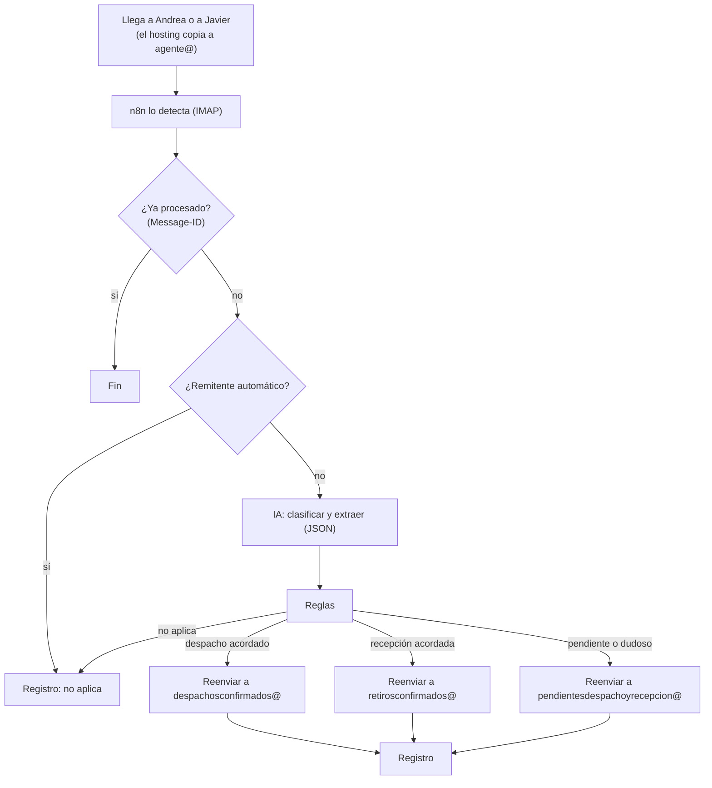

# 07 · Cómo funciona el clasificador (etapa 1)

**Qué hace:**
1. Lee una copia de los correos que llegan a **Andrea** y a **Javier**.
2. Decide si cada uno es un **despacho acordado**, una **recepción acordada**, un **pendiente**, o **no aplica**.
3. Reenvía los tres primeros a su casilla, con un resumen.

**Qué no hace:**
- agenda, Excel ni cupo de camiones;
- responder a clientes;
- tocar MADA;
- modificar las casillas de Andrea o de Javier.

## Recorrido de un correo



### 1. Entrada

- El hosting copia a `agente@` lo que **llega** a Andrea y a Javier, incluidos los correos en copia (CC).
- Lo que ellos **envían** no pasa por el reenvío. Para los correos que envía Javier (donde están la mayoría de las recepciones acordadas), su Outlook tendrá una regla que agrega `agente@` en copia (CC). **[pendiente: la configura Víctor]**
- Si el mismo correo le llega a los dos, entra dos veces, pero se procesa **una sola vez** porque tiene el mismo `Message-ID`.

### 2. Preparación (nodo Code)

- Saca el remitente, el asunto, la fecha y el `Message-ID`.
- Limpia el cuerpo: quita el HTML, las firmas y los mensajes antiguos citados, pero deja algo de contexto.
- **Del asunto saca sin IA** el número de cotización con su sufijo, el cliente y la obra, con este patrón:
  `Cotización Alzatec N°(\d+(-\d+)?) - (CLIENTE) - (OBRA)`

### 3. Clasificación con IA

El modelo recibe las definiciones, ejemplos reales sacados de la base de correos y el correo. Devuelve siempre este JSON:

```json
{
  "categoria": "despacho_acordado | recepcion_acordada | pendiente | no_aplica",
  "movimiento": "despacho | recepcion | null",
  "falta": ["fecha", "stock", "condicion_comercial", "cotizacion_final", "otro"],
  "n_cotizacion": "28484-01",
  "cliente": "…",
  "obra": "…",
  "fecha": "2026-10-09 | null",
  "camion": "cliente | alzatec | null",
  "resumen": "Cliente da conforme a la cotización y al plano; pide despacho para mañana viernes.",
  "confianza": "alta | media | baja"
}
```

### 4. Reglas (código, no IA)

| Orden | Regla | Resultado |
|---|---|---|
| 1 | `categoria = no_aplica` | Solo registro |
| 2 | `confianza = baja` y `movimiento` no es null | **Pendiente**, con la nota "revisar" |
| 3 | La cotización tiene sufijo (`-01`) y el correo no confirma que es la final | **Pendiente**, porque falta la cotización final **[validar con la base]** |
| 4 | Hay algo en `falta` | **Pendiente** |
| 5 | Ninguna de las anteriores | Se respeta la categoría de la IA |

Ante la duda, siempre se va a **pendientes**. Un despacho perdido es peor que uno de más en pendientes.

### 5. Reenvío (nodo Send Email, SMTP del hosting)

- **Para:** la casilla según la categoría.
- **Asunto:** `[DESPACHO ACORDADO] Re: Cotización Alzatec N°28484 - CLIENTE - OBRA`
- **Cuerpo:**
  - un resumen arriba: categoría, cotización, cliente, obra, fecha y, si es pendiente, **qué falta**;
  - debajo, el correo original **completo con sus adjuntos**, adjunto como `.eml` para poder abrirlo y responder desde ahí.

### 6. Registro

Cada correo queda registrado con:
- fecha y remitente;
- asunto;
- categoría y confianza;
- a qué casilla fue reenviado.

Este registro sirve para medir cuánto acierta el clasificador.

## Si algo falla

Te llega un correo a ti, el mantenedor. El correo original sigue en `agente@` y se reprocesa desde n8n.

## Cómo se pone en marcha

1. **Análisis de la base de correos** de Andrea y de Javier:
   - volumen por tipo;
   - qué frases indican "acordado" y cuáles "pendiente";
   - formatos de asunto;
   - remitentes automáticos.
2. **Prueba offline** con esos correos: medir cuánto acierta antes de conectar nada.
3. **Modo sombra** de 1–2 semanas: reenvía a una casilla de prueba y Andrea compara con su criterio.
4. **En vivo:** reenvía a las tres casillas reales.

## Mantenimiento

- **Primer mes, una vez por semana:** revisar el registro. Cada error se vuelve un ejemplo nuevo en las instrucciones de la IA.
- **Una vez al mes:** costo de la IA, espacio de `agente@`, actualizaciones de n8n.
