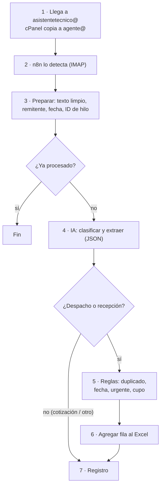

# 07 · Cómo funciona el agente (versión 1)

**Qué hace la v1:** clasificar cada correo y anotar los despachos y recepciones en el Excel de Pato, marcando SIN CUPO, URGENTE o REVISAR. Nada más.

**Qué no hace la v1:**
- No responde ni envía correos.
- No manda alertas por correo: la alerta es el color en el Excel.
- No actualiza filas cuando hay cambios de fecha o cancelaciones (esos quedan como REVISAR).
- No lee los adjuntos.
- No toca MADA.

## Qué correos procesa

- **Solo los que llegan a `asistentetecnico@`.** El reenviador de cPanel copia lo entrante, no lo que Andrea envía. Las cotizaciones que ella manda y sus propias respuestas nunca llegan al agente.
- Las copias (CC) sí llegan. Por ejemplo, un vendedor que copia a Andrea.
- **Filtro inicial barato**, antes de llamar a la IA: se descartan remitentes automáticos (no-reply, boletines, avisos de sistemas) con una lista que se mantiene a mano.
- **¿Solo respuestas (`Re:`)?** Se puede: en el trigger IMAP, con la regla `HEADER In-Reply-To ""`, o con un nodo IF que exija la cabecera `In-Reply-To`. **No se activa en la v1**, porque una devolución o un aviso de un vendedor pueden llegar como correo nuevo y se perderían. Primero se mide en el modo sombra qué parte de las solicitudes llega como respuesta. Si es prácticamente el 100%, se activa el filtro.

## Recorrido de un correo

Ejemplo: el jueves 15-10 a las 09:12 un cliente responde el hilo de la cotización:

> "Hola Andrea, pasamos a retirar lo de la cotización 4521 el lunes a las 9. Va el camión patente AB-CD-12, chofer Juan Pérez."



### 1. El correo llega

El correo llega a `asistentetecnico@` y Andrea lo ve igual que siempre. El reenviador de cPanel deja una copia en `agente@`.

### 2. n8n lo detecta

El nodo *Email Trigger (IMAP)* está conectado a `agente@` y se activa a los pocos segundos.

### 3. Preparar el correo (nodo Code)

- Saca el remitente, el asunto y la fecha y hora de recepción.
- Limpia el cuerpo: quita el HTML, las firmas largas y la parte citada vieja ("El jue, … escribió:"). Deja el mensaje nuevo, más un poco del hilo para dar contexto.
- Calcula el **ID de hilo**: el primer `References`, o si no hay, el `In-Reply-To`, o si no, el `Message-ID`.
- Si ese `Message-ID` ya está en la hoja *Registro*, termina. Así, si n8n se reinicia, no procesa dos veces el mismo correo.

### 4. Clasificar y extraer con IA

Se le manda al modelo:
- **Instrucciones fijas:** las definiciones de Andrea, 10–20 ejemplos reales y las reglas, por ejemplo "si no hay fecha clara, fecha = null".
- **El correo:** remitente, asunto, cuerpo limpio, y la **fecha y el día de la semana en que llegó** (jueves 15-10-2026), para que pueda traducir "el lunes".

Responde **siempre** con este JSON, porque se le pide salida estructurada:

```json
{
  "tipo": "despacho",
  "confianza": "alta",
  "fecha_texto": "el lunes a las 9",
  "fecha": "2026-10-19",
  "hora": "09:00",
  "cliente": "Constructora Cordillera",
  "obra": null,
  "n_cotizacion": "4521",
  "contacto": null,
  "transporte": "AB-CD-12 · Juan Pérez",
  "detalle": "Retira lo de la cotización 4521",
  "resumen": "Cliente retira cot. 4521 el lunes 19-10 a las 09:00"
}
```

| Campo | Valores |
|---|---|
| `tipo` | `despacho`, `recepcion`, `cotizacion`, `cambio_o_cancelacion`, `camion_alzatec`, `otro` |
| `confianza` | `alta`, `media`, `baja` |
| `fecha` / `hora` | En formato ISO, o `null` si no son claras. El modelo **nunca** inventa una fecha. |

### 5. Aplicar las reglas (nodo Code)

Las reglas son código normal, no IA. Así son predecibles y fáciles de ajustar.

| Orden | Regla | Resultado |
|---|---|---|
| 1 | `tipo` es `cotizacion` u `otro` | No va al Excel. Solo se anota en *Registro*. |
| 2 | `tipo` es `cambio_o_cancelacion` o `camion_alzatec`, o `confianza` es baja, o falta la fecha | Fila **REVISAR** |
| 3 | La fecha está en el pasado, es domingo o feriado, o está a más de 60 días | Fila **REVISAR** |
| 4 | Ya hay una fila con el mismo **ID de hilo**, tipo y fecha | No crea otra; solo lo anota en *Registro* |
| 5 | Ya hay una fila con el mismo ID de hilo pero **otra fecha** | Fila **REVISAR** ("posible cambio de fecha") |
| 6 | Los camiones de ese día (todas las filas, menos SIN CUPO y CANCELADO) ya llegan a la capacidad | Fila **SIN CUPO**, con el próximo día hábil que tiene cupo en *Detalle* |
| 7 | Hay menos de 2 días hábiles de anticipación | Fila **URGENTE** |
| 8 | Ninguna de las anteriores | Fila **POR CONFIRMAR** |

El cupo se calcula leyendo las filas del Excel con el nodo *Microsoft Excel 365 → Get Rows*, filtradas por fecha. **Solo cuenta camiones**, no inventario.

### 6. Escribir en el Excel

El nodo *Microsoft Excel 365 → Append* agrega la fila al final de la tabla `tblAgenda`:

| Fecha | Hora | Tipo | Cliente | Obra | N° cotización | Contacto | Transporte | Detalle | Estado | Origen | ID hilo |
|---|---|---|---|---|---|---|---|---|---|---|---|
| 19-10-2026 | 09:00 | Despacho | Constructora Cordillera | | 4521 | | AB-CD-12 · Juan Pérez | Retira lo de la cotización 4521 | POR CONFIRMAR | Correo 15-10 09:12 · «Re: Cotización 4521» | hilo-… |

Antes de escribir, el agente revisa que los **encabezados** sean los esperados. Si alguien cambió el formato del Excel, **no escribe** y avisa al mantenedor.

Pato ve aparecer la fila en su Excel abierto y le cambia el Estado a CONFIRMADO.

### 7. Registro

Cada correo procesado, vaya o no al Excel, queda en la hoja *Registro* con:
- fecha de recepción, remitente y asunto;
- tipo, confianza y qué hizo el agente;
- ID de hilo y `Message-ID`.

Esa hoja sirve para medir la precisión y para buscar qué pasó con un correo.

**Tiempo total:** entre 5 y 20 segundos por correo.

## Si algo falla

- Un *Error Workflow* de n8n **te manda un correo a ti**, el mantenedor, con el error y el correo afectado.
- El correo no se pierde: sigue en `agente@` y la ejecución fallida se puede **reintentar** desde n8n.
- Causas típicas:
  - venció la clave de Microsoft;
  - cambió la contraseña de `agente@`;
  - alguien cambió los encabezados del Excel;
  - la API de IA no respondió (n8n reintenta solo).

## Mantenimiento

| Cuándo | Qué |
|---|---|
| Primer mes, cada semana | Revisar la hoja *Registro* contra lo que pasó de verdad. Cada error de clasificación se vuelve un **ejemplo nuevo** en las instrucciones. Es la forma principal de mejorar el agente. |
| Cada día (2 minutos) | Ver si llegaron correos de error y cuántas filas REVISAR hay. Muchas REVISAR significan que faltan ejemplos. |
| Cada mes | Revisar el costo de la API de IA, el espacio de `agente@` (limpiar los viejos) y las actualizaciones de n8n. |
| Cuando cambie algo en Alzatec | Nueva capacidad, nuevos feriados, nuevas columnas: se ajustan las reglas del paso 5. |
| Cada ≤ 2 años | Renovar la clave de la app de Microsoft (solo si n8n no es Cloud). |

## Cómo se pone en marcha

1. **Offline:** con los correos y el Excel de 1–2 semanas, correr los pasos 3 a 5 sin conectar nada y medir cuánto acierta.
2. **Modo sombra:** conectar todo, pero escribiendo en una **copia** del Excel durante 1–2 semanas. Comparar con el Excel real de Pato.
3. **En vivo:** apuntar al Excel real cuando se cumplan las metas (≥ 95% de solicitudes detectadas).
