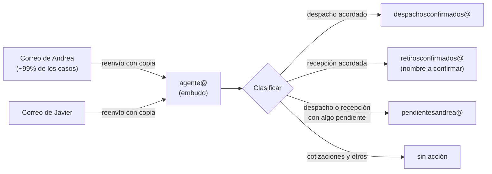

# 08 · Notas de la reunión (en curso)

> Sin datos personales de clientes. Los ejemplos reales quedan fuera del repo.

## Confirmado en la reunión

- **Camiones:** el ~90% de los despachos son con **camiones de los clientes** y el ~10% con **camiones de Alzatec**.
- **Agendamiento:** se puede **agendar aunque la cotización no esté aprobada**, pero **no se despacha** hasta que exista la cotización final.
- **Versiones de la cotización:** cuando la cotización tiene una observación del cliente ("un pero"), Andrea emite una nueva con **el mismo número más un guion**, por ejemplo `28484-01`. No se despacha hasta tener la versión final.
- **Asunto típico:** `Re: Cotización Alzatec N°<número> - <CLIENTE> - <OBRA>`. De ahí se pueden sacar el número de cotización, el cliente y la obra sin IA.
- **Ejemplo de "respuesta óptima"** (el cliente acepta y pide despacho):
  - el cliente acusa recibo y da conforme a la cotización y al plano;
  - pide coordinar con un contacto en obra el despacho "para mañana viernes";
  - el correo llega con copia a varias casillas internas (pfarias@, departamentotecnico@, abozzo@, cmontes@, jpmontes@ y otras).
- **Casilla vista en pantalla:** `departamentotecnico@alzatec.com`, en Outlook. **(confirmar si es la de Andrea o si es asistentetecnico@)**

## Alcance definido en la reunión: etapa 1 = solo el clasificador

- **Entrada:** los correos que llegan a **Andrea** y a **Javier**, copiados a `agente@alzatec.com`, que funciona como **embudo**.
- **Clasificación en 3 categorías:**
  1. **Despacho acordado** → `despachosconfirmados@`
  2. **Recepción acordada** → `retirosconfirmados@` (en las notas aparece como "retiros@confirmados"; **confirmar el nombre**)
  3. **Pendiente**: un despacho o una recepción al que **le falta algo** (fecha, stock, condición comercial o cotización final) → `pendientesandrea@`
- Las **cotizaciones** (25–35 diarias) y el resto **no se mueven**.
- **Sin Excel ni agenda en la etapa 1.** Solo se clasifican correos. El Excel de Pato queda para después.
- Alzatec entregará una **base de correos de los últimos meses** de Andrea y de Javier para analizarla.
- **Ya existe `devoluciones@alzatec.com`.**
- **Víctor maneja el hosting.** Con él se crean las casillas y los reenvíos.

## Cómo funciona hoy el acuerdo (lo que se entendió)

- Para que un despacho esté **acordado** se tienen que cumplir varias condiciones: **condición comercial**, **fecha** y **stock**.
- La **vendedora** (Patricia o Magaly) filtra esos correos, pregunta fecha y stock, responde, **asigna la fecha** y le manda un correo a **Patricio**.
- Cuando un vendedor coordina un despacho por teléfono, debe… **(quedó incompleto en las notas; completar)**

## Después de la reunión

- **Víctor Sánchez** (Informática de Alzatec) preguntó, de parte de gerencia, qué se necesita de los correos **`departamentotecnico@alzatec.com`** y **`devoluciones@alzatec.com`**. Esas son las dos casillas de entrada del embudo. **(confirmar cuál usa Andrea y cuál Javier)**

## Preguntas abiertas (críticas)

1. ¿Cuáles son las direcciones exactas de **Andrea** y de **Javier**? (En la captura aparecía `departamentotecnico@`.)
2. ¿**"Retiros confirmados" = recepciones**, es decir, equipos que vuelven? Ojo: los clientes usan "retiro" para venir a buscar. Para evitar confusiones conviene llamarla `recepcionesconfirmadas@`.
3. ¿Las recepciones van a una casilla nueva, o a la **`devoluciones@`** que ya existe?
4. ~~¿La vendedora copia a Andrea?~~ **No importa:** en la etapa 1 solo se clasifica lo que llega a Andrea y a Javier. Las señales de "acordado" y "pendiente" se van a sacar del **análisis de la base de correos** de los últimos meses de ambos, que entregará Alzatec.
5. ¿Quién lee cada una de las 3 casillas? (¿Pato las de confirmados y Andrea la de pendientes?)
6. Un correo que llega a Andrea **y** a Javier se procesa **una sola vez** (se detecta por `Message-ID`). Confirmar que eso es lo esperado.
